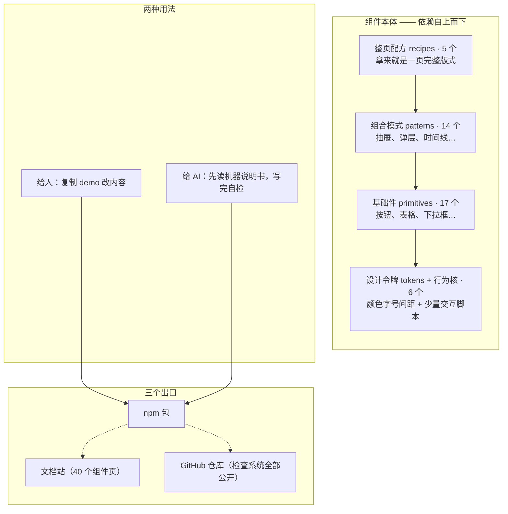

# agentcss 是怎么组成的

> 写给第一次接触这个项目的人。不需要先懂前端工程，读完能回答三个问题：
> 这是什么、东西怎么组织、靠什么保证不出乱子。

**一句话**：这是一个给手机网页用的**现成零件库**——按钮、表格、抽屉、整页版式都有，
拿来就能用。它有三个少见的特点：

- **不装任何依赖**。把这个库装进项目，你的 `node_modules` 不会多出任何别的东西。
- **类名就是说明书**。样式全靠类名控制，不要求写初始化脚本、不绑定任何框架。
- **专门照顾 AI 编码助手**。每个组件都有一份机器可读的"说明书"，AI 先读它再写代码，
  写完还能用配套命令自己检查。

规模：40 个组件（全部稳定可用）、约 1 MB 的 npm 包、全库样式总量锁死在 172 KB 以内。

## 一张图看懂



读法：想用一个小按钮，拿 `02-primitives` 里的就行；想要一整页报表，直接拿
`04-recipes`。上面的层会用到下面的层，反过来不会——所以拆哪儿都拆得动。

## 四层组件，像盖房子

| 层 | 是什么 | 打个比方 | 数量 |
|---|---|---|---|
| `01-tokens` | 颜色、字号、间距这些"数值表"，浅色/深色两套主题；附 6 个小交互脚本（弹窗关闭、焦点归位这类） | 调色盘和刻度尺 | 1 套 |
| `02-primitives` | 最小的独立组件：按钮、卡片、表格、下拉框 | 砖和预制板 | 17 |
| `03-patterns` | 需要多个组件配合的场景：抽屉、弹层、标签页、时间线 | 预制房间 | 14 |
| `04-recipes` | 一整页的成品版式：报表页、应用外壳、财务页 | 样板房 | 5 |

另有 `09-assets`（4 个独立小资产，比如图表底座），不属于这套分层，按需取用。

## 目录地图

| 目录 | 放什么 |
|---|---|
| `01-tokens/` … `04-recipes/`、`09-assets/` | 上面说的组件本体，每个组件自带可打开的 demo 页和说明 |
| `ai/` | 给 AI 看的机器说明书（4 份 JSON）和一个命令行工具 |
| `05-audit/` | 自动检查系统（下节讲），全部公开、任何人可以运行 |
| `docs/` | 设计与工程文档（本文在这里） |
| `dist/`、`esm/`、`types/` | 构建产物，由源码自动生成，不许手改 |

## 修改一处，处处自动跟上

这个项目最讲究的一件事：**同一份数据只存一个地方，别的都由它自动生成。**

- 40 个组件的清单（类名、状态、无障碍属性）只写在 `ai/components.json` 一处。
  文档站的 46 个页面、给 AI 的摘要文本，全部由这份清单自动生成——
  有一个自动检查专门盯着"生成物和清单是否一致"，改了清单忘了重新生成就会红。
- 关键数字同理：文档里写的组件数、检查数，都有自动检查对着源头核。

好处很直接：文档不会和实现"各说各话"，因为大部分文档本来就是实现生成的。

## 怎么保证不出乱子：一个自动验收系统

仓库里有一套自动检查（这个项目里叫"门禁"），共 **251 项**，像三道验收：

| 什么时候跑 | 跑多少 | 多快 | 查什么 |
|---|---|---|---|
| 每次提交前 | 5 项 | 约 7 秒 | 说明书、页面结构、文案、类型有没有被改坏 |
| 每次推送时 | 128 项 | 约 3.5 分钟 | 以上全部，外加所有不需要浏览器的检查 |
| 发布之前 | 251 项 | 约 10 分钟 | 再加真浏览器实测、逐像素视觉比对、安装包体检 |

三条规矩让它长期可信：

1. **每个检查先证明自己能抓到问题**——故意弄坏一个组件，检查必须变红；
   把检查关掉后问题必须重新出现。做不到这一点的检查不算数。
2. **"跳过"不等于"通过"**——环境缺浏览器就明确标"本次没查"，绝不悄悄变绿。
3. **没测过就说没测**——真机只在 5 类环境验证过，其余内核明说"未验证"，不写"应该没问题"。

## 给 AI 编码助手怎么用

机器说明书在 `ai/` 目录，四份 JSON 覆盖：每个组件的类名与状态、已知的坑、
设计数值、交互脚本的行为。配套命令行工具（装完这个包就能用）：

```bash
npx agentcss ai components --json        # 列出全部 40 个组件
npx agentcss ai check page.html --json   # 检查你写出来的页面合不合规范
npx agentcss ai shot page.html --width=390,1440   # 按真实手机宽度截图
npx agentcss ai scaffold report/finance  # 生成一页报表的最小骨架
```

流程就是：**读说明书 → 出骨架 → 填内容 → 自己检查**。最后一步不是可选项——
"写完了"和"写对了"是两件事。

---

*本文数字的出处：组件数来自 `ai/components.json`；检查项数以 `05-audit/check-all.sh`
实际注册为准；样式预算见 `docs/BUDGET.md`。均为 2026-11-05 的实测值。*
